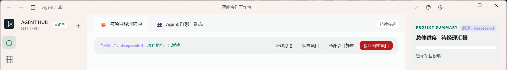

# 原生云母与标题栏验证

日期：2026-10-23。修改前应用备份：agent-message-hub-before-mica-app.zip。

- 原生窗口测试 3 项通过：真实系统 Snap 悬停菜单、DWM 原生圆角、6 个附属窗口生命周期及草稿保留。
- Mica 接口启用成功，WebView2 默认背景 alpha=0 已读回确认；实际截图检查了原生按钮与标题栏背景一致及导航/侧栏材质。
- 原生最大化命中 HTMAXBUTTON=9，关闭命中 HTCLOSE=20；按钮避让区延伸到右侧可见内容边界，缩放/DPI 改变后间隙不超过 2 像素。
- 聊天布局在 1440×900、1024×600、600×800 通过，阅读位置/展开保持及 Agent 卡片测试通过。
- 未启动真实模型推理，未修改在线项目或自动重启正在运行的 Hub。

官方接口参考：[DWM 系统背景](https://learn.microsoft.com/en-us/windows/win32/api/dwmapi/ne-dwmapi-dwm_systembackdrop_type)、[WebView2 默认背景](https://learn.microsoft.com/en-us/microsoft-edge/webview2/reference/win32/icorewebview2controller2)。
